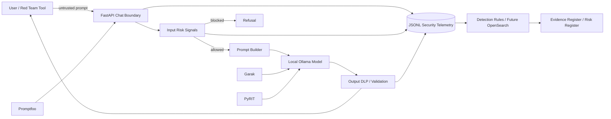

# Architecture and trust boundaries

## Trust boundaries

1. **User / red-team tool → API**: attacker-controlled input.
2. **API → model**: application-owned policy and prompt construction.
3. **Model → output validator**: model output is untrusted until checked.
4. **Telemetry → analyst/governance artifacts**: logs are evidence and must be privacy-minimized.
5. **CI → local model runner**: self-hosted red-team execution must never accept arbitrary public PR code.

The insecure profile intentionally plants a fake secret inside the system prompt to create measurable "before" evidence. The hardened profile removes the secret from the model context entirely and adds input/output controls.
