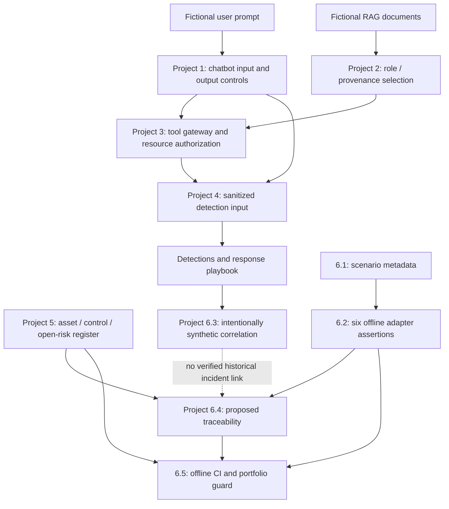

# Cyranta AI Security Lab — Project 6 research portfolio

**Scope:** local-first, fictional Cyranta application, RAG and agent security research. **Status:** The private Project 6.5 milestone was merged and locally tested on 2026-11-06. This separately adapted public hosted-only edition has not yet passed its own full regression/CI. **Not a production security certification or release approval.**

## Executive briefing (one page)

**Problem.** AI systems span several independent trust boundaries: a user prompt, retrieved content, tool authorization, detection telemetry and the governance record. A locally passing test in one boundary is not proof that another boundary or the whole product is secure.

**Approach.** Cyranta combines intentionally vulnerable/hardened chatbot exercises (Project 1), role-filtered fictional RAG (Project 2), a server-enforced agent tool gateway (Project 3), monitoring and incident simulations (Project 4), and asset/risk/control records (Project 5). Project 6 adds six static scenario definitions, a deterministic offline adapter runner, synthetic alert correlation, a limited finding-to-governance crosswalk and CI policy inspection.

**Observed local results.** Before this Project 6.5 change, the owner reported **589 passing pytest cases** on merged `main` commit `99aaea2a5a665c30f0339420de8a10f272a8e824`, Ruff and Bandit passing, and GitHub `security-gate` push run `42187458408` successful for that exact SHA. Those are **owner-supplied execution records**, not independent attestation. The new public edition must be tested and reviewed separately; never reuse those numbers as proof of modified code.

**Decision and residual risk.** The Project 5 `CYRANTA-DEP-001` ChromaDB `1.5.9` dependency risk remains `open / pending_review`, with no assigned risk owner. Five asset owners and seven control owners remain unassigned. Historical retest narratives are not independently substantiated, Project 6.3 incident candidates are fictional, and finding-control proposals remain unapproved. No assurance certification, production readiness, or risk acceptance is claimed.

**Recommended next action.** Keep this as a research portfolio. Obtain independent technical and governance review, assign owners, separately resolve/audit the RAG dependency, validate real Chroma/Ollama and controlled response paths under authorized conditions, and establish provenance-backed evidence before considering release assurance.

## Architecture and trust boundaries



**Boundaries:** user text is untrusted; retrieved documents must not grant new authority; a tool gateway controls effective action; sanitized detector outputs do not establish real incidents; signed/independent governance review is separate from tests. The Project 6.2 RAG exercises mock retrieval and do **not** query ChromaDB or Ollama.

## Project 6 exercise map

| Scenario | Offline path | Limits / necessary follow-up |
|---|---|---|
| `CYR-P6-SCN-001` | Chat input blocking and planted-marker output redaction | One fixed fictional pattern; no exhaustive jailbreak assurance |
| `CYR-P6-SCN-002` | Encoded-input blocking | Fixed encoding; not proof against all transformations |
| `CYR-P6-SCN-003` | RAG role-filter request with in-memory query mock | Actual vector DB not exercised |
| `CYR-P6-SCN-004` | RAG trusted-document context-selection mock | Live ingestion/model generation not exercised |
| `CYR-P6-SCN-005` | Agent denied mock refund with no mock state mutation | No real financial tool or production authorization |
| `CYR-P6-SCN-006` | Synthetic detection alerts | Project 6.3 request-ID linkage is deliberately fictional |

The original Project 6.1 manifest files remain `execution_status: not_run`; results are separate unsigned outputs. Do not rewrite scenario metadata to imply it was run.

## Reproduction — Windows PowerShell

From the repository root on a reviewed **committed and clean revision**:

```powershell
$py = '.\.venv-agent\Scripts\python.exe'
& $py -m validation.project6.schema validate
if ($LASTEXITCODE -ne 0) { throw 'STOP: P6.1 invalid' }
& $py -m validation.project6.portfolio check
if ($LASTEXITCODE -ne 0) { throw 'STOP: P6.5 CI boundary invalid' }
& $py -m pytest -q
if ($LASTEXITCODE -ne 0) { throw 'STOP: Regression failed' }
& $py -m ruff check .
if ($LASTEXITCODE -ne 0) { throw 'STOP: Static lint failed' }
& $py -m compileall -q validation
if ($LASTEXITCODE -ne 0) { throw 'STOP: Syntax check failed' }
& $py -m bandit -q validation/project6/portfolio.py
if ($LASTEXITCODE -ne 0) { throw 'STOP: Bandit failed' }
```

On a clean merge revision, choose a new output folder for **each** evidence exercise, never overwriting previous results:

```powershell
$out = 'telemetry/governance/project6-5-postmerge'
if (Test-Path $out) { throw 'STOP: Evidence directory already exists' }
& $py -m validation.project6.portfolio build --output-dir $out
if ($LASTEXITCODE -ne 0) { throw 'STOP: Build failed' }
& $py -m validation.project6.portfolio verify --output-dir $out
if ($LASTEXITCODE -ne 0) { throw 'STOP: Verification failed' }
```

Keep ignored `telemetry/governance/` material local. Never upload `.env`, local Ollama/PyRIT/Garak databases, unreviewed raw attack results or customer information. `check` is safe for hosted CI and reads source code/registry declarations only. `build`/`verify` are explicit local commands and do **not** call external services or observe GitHub CI.

### CI matrix and present restrictions

| Job / workflow | Execution | What is checked | Not claimed |
|---|---|---|---|
| `security-gate` | GitHub-hosted Ubuntu, `push` to `main` and PRs | Python syntax, Ruff, offline CI policy, pytest, Bandit, core/agent `pip-audit` | No live Ollama, ChromaDB end-to-end assurance or independent review |
| Local red-team | Not present in the public edition | No self-hosted runner jobs are published | Local model experiments remain private |
| P6.5 `portfolio check` | Offline, read-only | Public hosted-only CI, absence of private runner files and exact safe `.env.example`, unchanged open-risk and scenario declarations | No trusted authorship, job-by-job CI provenance or governance approval |

**Known CI limitations:** workflow actions are referenced by version tags rather than full commit SHAs, and the dedicated RAG dependency risk is **not** a passing core/agent audit. Pinning workflow actions and deciding on the RAG dependency require a separate reviewed change. The private lab's self-hosted workflow and nested `scripts/local_redteam_gate.ps1` are not published in this edition; their internal behavior has not been reviewed here. The public workflow guard validates only reviewed file-level declarations, not arbitrary external GitHub settings or executed dependencies. GitHub branch protections, reviewer settings and runner associations remain separate release checks.

## Human-readable attack → control → retest story (fictional scope)

The `CYR-AGENT-001` historical narrative describes a tool-authorization issue and a local mock-tool retest. The reviewed crosswalk proposes `CYR-CTL-003` and `CYR-CTL-004` based on that documentation and declares the links **unapproved**. The 6.2 runner independently exercises a fixed synthetic denial through the current mock tool gateway; it does *not* establish that the historical test's original logs are authentic or that the two exercises are a single provenance-backed retest. That missing binding remains an explicit portfolio limitation.

No Project 6.3 synthetic incident candidate is attributed to any historical finding. `CYRANTA-DEP-001` is a separate registered risk with explicit `CYR-CTL-006` / `CYR-CTL-007` registry associations and is not closed by this narrative.

## Three-to-five-minute demo script

- **0:00–0:40 — Scope and safety.** Show the README and explain fictional assets, planted fake data and authorized local boundaries. Say that green CI is regression evidence, not assurance.
- **0:40–1:30 — Scenario catalogue and offline runner.** Show one manifest (`execution_status: not_run`) and the separate Project 6.2 report, explaining the in-memory RAG mock and fixed gateway assertions.
- **1:30–2:15 — Monitoring exercise.** Open sanitized Project 6.3 incident cases: five events, three alerts, two fictional candidates. Explain shared validated request ID and five-minute window. Do not present them as real incidents.
- **2:15–3:05 — Governance.** Open the Project 6.4 crosswalk: three historical narratives, one open dependency risk, zero approved finding-control links, five unassigned asset owners, seven unassigned control owners.
- **3:05–4:00 — CI policy and evidence.** Show `portfolio check`, run the new tests and verify the **matching** post-merge GitHub CI SHA separately with `gh`. Demonstrate no raw attack evidence is uploaded by the self-hosted workflow.
- **4:00–4:30 — Limits and next steps.** State unresolved Chroma risk, missing independent provenance, no production release authorization, and separate authorized steps for real deployment.

Keep screen recordings free of any `.env` value, credentials, raw prompt transcripts, real client data and local filesystem paths that reveal private identities.

## Evidence/failure interpretation

- `check` failure means CI/registry assumptions changed and need human review. It does **not** mean an exploit occurred.
- A failed regression/security gate requires diagnosis; do not suppress it with `continue-on-error` or alter the open-risk record to make CI green.
- `build` refuses existing paths; generate a new ignored evidence folder rather than deleting previous evidence.
- `verify` checks source hashes, deterministic content and Git revision context. An unsigned manifest can be replaced by someone who controls the local files; this is **not** forensic proof.
- `revision_matches=true` plus `clean_committed_local_record=true` indicates only a clean local snapshot at that Git commit.
- `matching_postmerge_github_ci_verified` is always `false` in local evidence. Check GitHub separately against the exact merge SHA; do not claim the module performed a GitHub API verification.

## Closure and release decision

**Public-edition engineering acceptance** requires full regression and hosted CI success on an exact new clean public `main` commit, plus sanitized-source review and separate GitHub settings inspection. The private Project 6.5 merge result does not certify this modified public edition. The historical finding-to-verified-retest objective remains **incomplete** without independent original evidence. Research portfolio completion is distinct from control effectiveness, risk acceptance, compliance certification, or a security-assured release. No tag implying security certification should be created.
